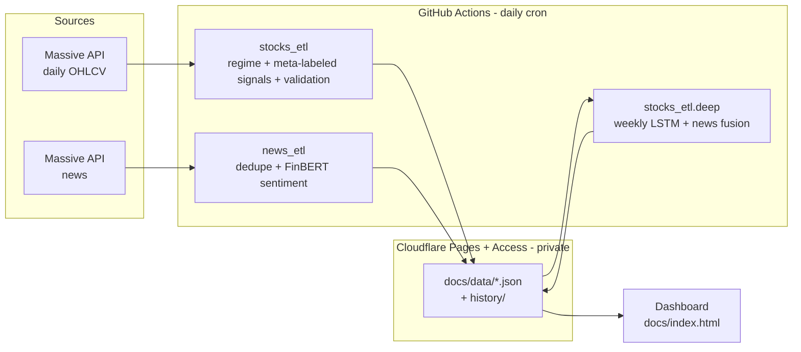

> **Internal — not for distribution.** Technical notes for the maintainers. The public-facing pitch is in README.md.

# StockSentinel

**Regime-aware quant signals with honest validation — a fully automated, zero-cost data pipeline.**

Every day, GitHub Actions downloads prices from the Massive API for a diversified universe (21 stocks across 8 sectors plus SPY, QQQ, GLD and TLT), detects the **market regime**, generates **meta-labeled signals** with triple-barrier risk and **fractional Kelly** sizing, validates them out-of-sample with **Purged K-Fold, CPCV and the Deflated Sharpe Ratio**, and publishes everything as static JSON to a **private** dashboard (Cloudflare Pages behind Cloudflare Access). Massive news headlines are scored with **FinBERT**, and weekly jobs evaluate an LSTM and a price + news cross-attention model behind a promotion gate.

The methodology follows the quantitative approach described by Julián Castillo (Castle Quant), which builds on López de Prado's *Advances in Financial Machine Learning*.

**Live dashboard: https://trading.oceandatagroup.ai**

> ⚠️ **Academic project.** Signals are for demonstration only and are not investment advice.

[](https://github.com/Pipe199x/StockSentinel/actions/workflows/etl-stocks-cron.yml)
[](https://github.com/Pipe199x/StockSentinel/actions/workflows/etl-news-cron.yml)

## Architecture



- **`stocks_etl/`** — downloads split-adjusted daily OHLCV from Massive over the plan's rolling 10-year window (it starts in late 2016 and moves forward daily, floor 2016-11-14; NYSE calendar; 2008 is not covered). Only **complete sessions** are used (`etl_common/sessions.py`): a bar is kept once its session closed 30 minutes ago. Prices then pass a data-quality gate (`etl_common/validation.py`: fatal problems stop the run, anomalies are flagged in `validation_report.json` → `data_quality`). Cash dividends (Massive `/v3/reference/dividends`, converted to the split-adjusted price scale with `/v3/reference/splits`) are credited to longs and debited to shorts for ex-dates in (entry day, exit day], identically in the labels and the paper ledger (`etl_common/corporate_actions.py`, table `history/dividends.csv`); a split during an open position rescales the ledger's stored prices. The run starts at 01:30 UTC (after the post-market, so the volume bar is final) with a 04:00 UTC backup; every scheduled run skips when `manifest.json` already covers the last completed session. Right before the features it updates the news up to the 20:00 UTC cutoff (composite action `.github/actions/update-news`):
  - `features.py`: stationary features only (log returns, fractionally differentiated price, realized and GARCH volatility, Hurst exponent, Ornstein-Uhlenbeck z-score and half-life, beta). No RSI or moving averages.
  - `regime.py`: GARCH(1,1) with Student-t innovations and a 3-state hidden Markov model, forward-filtered. With `pit_refit` (on), their parameters are refitted once a year using only earlier data, and the first 500 sessions are training only: no look-ahead in the parameters either.
  - `primary.py`: a fixed rule. Stay flat in a market stress regime and use momentum when Hurst ≥ 0.5 (20-session hold). OU mean reversion is still implemented but switched off (`strategies: [momentum]`) since variant V4 (see `research/replay/`).
  - `labeling.py`: triple barrier with volatility-scaled take profit and stop loss, plus a time barrier (20 sessions for momentum; the OU half-life barrier only applies to the disabled mean-reversion leg).
  - `meta_model.py`: an XGBoost classifier that estimates P(the primary signal is right after costs), sized at ½ Kelly × volatility target and capped so the trade's 1% Expected Shortfall costs at most `max_es_loss` (1%) of equity. The report adds a `stress_windows` breakdown (COVID, 2022, April 2025), its `config_hash`, `data_quality`, `data_freshness` and the `environment` that produced it.
  - `validation.py`: Purged K-Fold with embargo, CPCV, Deflated Sharpe, sample-size test and a trial log.
  - `risk.py`: t-Student VaR/ES, the ES position cap, Cornish-Fisher VaR, fat-tailed Monte Carlo and losing-streak math.
  - `paper.py`: simulated paper trading (Gate 0). Each published signal fills at the next session's open and exits with the backtest's rules; a signal published after that open is marked `missed`. Every position is re-walked from its entry on each run (a pure function of complete bars). The ledger is `history/paper_trades.csv`, tagged with the `config_hash` and `strategy_label` that produced each row; `paper_summary.json` judges only the current configuration's trades against the backtest (Gate 0 with a confidence interval: pass / fail / inconclusive / collecting).
  - `advisor_report.py` (with `metrics.py`, `montecarlo.py`, `regime_analytics.py`, `book.py`): the advisor's measurement layer, informational only (a test proves it changes no trade). Calendar-time portfolio metrics (Sortino over all sessions, max drawdown, Calmar, CAGR, Sharpe net of T-bills from FRED DTB3), effective sample size from label uniqueness and a Deflated Sharpe on it, seed stability, per-regime and scenario coverage, FFD stationarity, red flags, HMM regime durations and switch odds, GARCH diagnostics, the post-shock window, a Monte Carlo of the strategy (block bootstrap and Student-t), the live book's Expected Shortfall under stress correlations, Gate 1 (capital) and open-trade re-scoring. Published in `validation_report.json`, `paper_summary.json` and `risk_report.json`.
- **`stocks_etl/deep/`** — weekly (Saturday) LSTM and LSTM + FinBERT cross-attention meta-models, compared with the live XGBoost on the same events and the same features (news included). A model is flagged `promoted` if its Deflated Sharpe exceeds 0.95 and it beats XGBoost. **Informational:** nothing trades on it yet. The FinBERT embeddings of the fusion model are computed by this job and kept in the Actions cache (not in git).
- **`news_etl/`** — fetches the last 2 days of Massive news for the 21 stocks in `universe.json`, scores them with [ProsusAI/finbert](https://huggingface.co/ProsusAI/finbert) on CPU and appends them to `history/news_sentiment.csv` exactly like the historical backfill the meta-model was trained on (Massive article ids, the more-than-3-tickers round-up rule on all Massive tags, no spam filter or daily cap). The dashboard feed (`news_latest.json`, `news_history.ndjson`) is tagged with Massive's own tickers, capped per ticker per day and spam-free. Runs at 12:15 UTC (20:00 UTC backup) and inside every stocks run.
- **`web/`** — the dashboard source: Next.js 16 static export built with Aceternity UI Pro components (registry `@aceternity`) and the Ocean Data Group watermark. `npm run publish:docs` builds it into `docs/`; the `web.yml` workflow does that on every push to `main` that touches `web/`. Pages fetch `docs/data/*.json` at runtime, so daily data updates need no rebuild.
- **`docs/`** — the built dashboard plus the published dataset, served by Cloudflare Pages (private, behind Access). Daily data commits also keep the scheduled workflows active.
- **`api/`** — an optional FastAPI serving layer over the same data, runnable locally.

## Live data endpoints

| Endpoint | Content |
|---|---|
| [`manifest.json`](https://trading.oceandatagroup.ai/data/manifest.json) | Last-updated timestamps per pipeline |
| [`universe.json`](https://trading.oceandatagroup.ai/data/universe.json) | Tickers by sector (single source: `stocks_etl/config.yaml`) |
| [`prices_latest.json`](https://trading.oceandatagroup.ai/data/prices_latest.json) | Last 60 days of prices per ticker |
| [`signals_latest.json`](https://trading.oceandatagroup.ai/data/signals_latest.json) | Regime, setup, side, P(success), Kelly size, barriers and risk per ticker |
| [`validation_report.json`](https://trading.oceandatagroup.ai/data/validation_report.json) | Out-of-sample stats, CPCV paths, DSR, trials, correlations, limitations |
| [`risk_report.json`](https://trading.oceandatagroup.ai/data/risk_report.json) | Regime durations and switch odds, GARCH alerts, post-shock window, strategy Monte Carlo, live book risk, review horizon |
| [`deep_report.json`](https://trading.oceandatagroup.ai/data/deep_report.json) | Weekly LSTM / news-fusion evaluation and promotion status |
| [`news_latest.json`](https://trading.oceandatagroup.ai/data/news_latest.json) | Recent news with FinBERT sentiment |
| [`history/`](https://trading.oceandatagroup.ai/data/history/prices_history.csv) | Price history, news + FinBERT embeddings, signal history and `trials_log.csv` (the old `predictions_history.csv` is kept read-only) |

## Running locally

```bash
pip install -r stocks_etl/requirements.txt
python -m pytest tests -q
python -m stocks_etl.stocks_etl --config stocks_etl/config.yaml

# Weekly deep models (torch CPU)
pip install torch --index-url https://download.pytorch.org/whl/cpu
pip install -r stocks_etl/deep/requirements.txt
python -m stocks_etl.deep.train --config stocks_etl/config.yaml

# Prices and news need a Massive key (Stocks Developer); FinBERT downloads ~440MB on first run
cp .env.example .env   # set MASSIVE_API_KEY
pip install torch --index-url https://download.pytorch.org/whl/cpu
pip install -r news_etl/requirements.txt
python -m news_etl.news_client --out data/news_raw.ndjson --tickers AAPL,MSFT,GOOGL --days 2
python -m news_etl.news_etl --config news_etl/config.yaml
```

Optional local API:

Dashboard (Node 22):

```bash
cd web && npm install
npm run dev            # copies ../docs/data to public/data and serves http://localhost:3000
npm run publish:docs   # static build synced into ../docs (keeps docs/data, CNAME, .nojekyll)
```

```bash
pip install -r api/requirements.txt
uvicorn api.app.main:app --reload
# GET /v1/stocks, /v1/signals, /v1/validation, /v1/universe, /v1/news, /v1/manifest
```

## Notes and limitations

- **Data license:** Massive's individual plan forbids redistributing its data. The repo is private and the dashboard is served by Cloudflare Pages behind Cloudflare Access (owner's email only). Never make either public while Massive data is in `docs/data`.
- Massive Stocks Developer costs $79/month and is the only data source (prices and news); `MASSIVE_API_KEY` is an Actions secret.
- Every published performance number is out-of-sample (purged CV), and every change under `quant:` in `stocks_etl/config.yaml` is logged as a trial (its config hash) that the Deflated Sharpe penalizes. Code and data fixes that move published numbers are not trials; they are listed below. CI is the only publisher of record: the same config on the same prices gave DSR 0.817 on Windows / Python 3.13 and 0.577 on the Linux CI runner, so locally generated `docs/data` is never committed. Known gaps are published in `validation_report.json` → `limitations`. These include survivorship bias: the point-in-time re-test with delisted stocks (`research/massive/`, M2) did not reach DSR 0.95, so there is no proven edge.
- News covers the 21 stocks of the universe (until 2026-11-14 the dashboard feed and the embeddings covered only AMZN, MSFT and GOOGL). The price + news fusion model stays in `insufficient_data` until there are enough events with news.

### Changes that moved published numbers (not trials)

- 2026-11-14 — complete sessions only and paper positions re-walked from entry (a partial 11-13 bar had been used); news ids aligned with the backfill (legacy duplicates removed); VaR/ES published from the point-in-time GARCH that sizes the trade.
- 2026-11-14 — cash dividends included in trade returns (before, every ex-dividend drop counted as a loss for longs and a gain for shorts). Same config on the same prices (offline replay): 535 → 545 trades, EV/trade 0.238% → 0.426%, SR/trade 0.0899 → 0.0945, DSR 0.817 → 0.841. A correction, not an edge: DSR is still below 0.95.
- Everything else runs on free tiers: GitHub Actions (private-repo minutes), Cloudflare Pages and Access, Hugging Face model hosting. yfinance is used only by the research baselines (`research/requirements.txt`).
