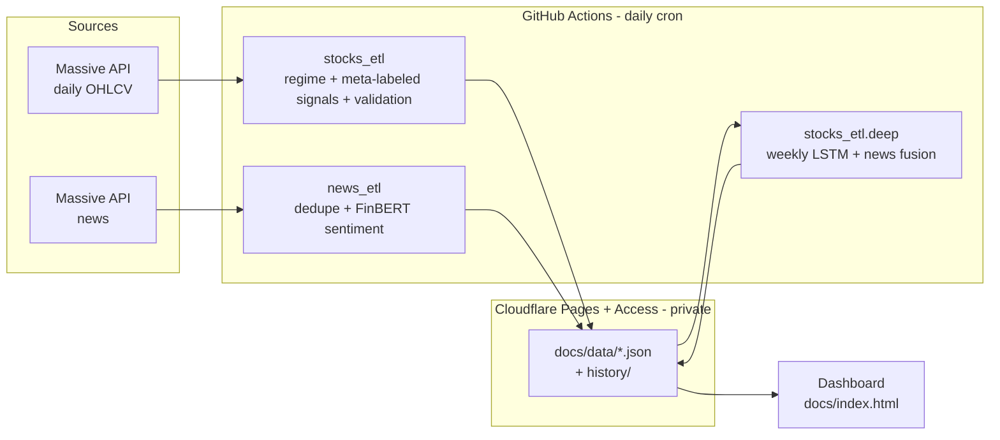

> **Internal — not for distribution.** Technical notes for the maintainers. The public-facing pitch is in README.md.

# StockSentinel

**Regime-aware quant signals with honest validation — a fully automated, zero-cost data pipeline.**

Every day, GitHub Actions downloads prices from the Massive API for a diversified universe (21 stocks across 8 sectors plus SPY, QQQ, GLD and TLT), detects the **market regime**, generates **meta-labeled signals** with triple-barrier risk and **fractional Kelly** sizing, validates them out-of-sample with **Purged K-Fold, CPCV and the Deflated Sharpe Ratio**, and publishes everything as static JSON to a **private** dashboard (Cloudflare Pages behind Cloudflare Access). Massive news headlines are scored with **FinBERT**, and weekly jobs evaluate an LSTM and a price + news cross-attention model behind a promotion gate.

The methodology follows the quantitative approach described by Julián Castillo (Castle Quant), which builds on López de Prado's *Advances in Financial Machine Learning*.

**Live dashboard: https://trading.oceandatagroup.ai**

> ⚠️ **Academic project.** Signals are for demonstration only and are not investment advice.

[](https://github.com/Pipe199x/StockSentinel/actions/workflows/etl-stocks-cron.yml)
[](https://github.com/Pipe199x/StockSentinel/actions/workflows/etl-news-cron.yml)

## Architecture



- **`stocks_etl/`** — downloads split-adjusted daily OHLCV from Massive since 2016-11-14, the plan's rolling 10-year window (NYSE calendar; 2008 is not covered), and runs the quant pipeline at 22:30 UTC, after market close, with a 07:00 UTC backup run that only works if the primary did not publish:
  - `features.py`: stationary features only (log returns, fractionally differentiated price, realized and GARCH volatility, Hurst exponent, Ornstein-Uhlenbeck z-score and half-life, beta). No RSI or moving averages.
  - `regime.py`: GARCH(1,1) with Student-t innovations and a 3-state hidden Markov model, forward-filtered. With `pit_refit` (on), their parameters are refitted once a year using only earlier data, and the first 500 sessions are training only: no look-ahead in the parameters either.
  - `primary.py`: a fixed rule. Stay flat in a market stress regime and use momentum when Hurst ≥ 0.5 (20-session hold). OU mean reversion is still implemented but switched off (`strategies: [momentum]`) since variant V4 (see `research/replay/`).
  - `labeling.py`: triple barrier with volatility-scaled take profit and stop loss, plus a half-life time barrier.
  - `meta_model.py`: an XGBoost classifier that estimates P(the primary signal is right after costs), sized at ½ Kelly × volatility target and capped so the trade's 1% Expected Shortfall costs at most `max_es_loss` (1%) of equity. The report adds a `stress_windows` breakdown (2008, COVID, 2022, April 2025).
  - `validation.py`: Purged K-Fold with embargo, CPCV, Deflated Sharpe, sample-size test and a trial log.
  - `risk.py`: t-Student VaR/ES, the ES position cap, Cornish-Fisher VaR, fat-tailed Monte Carlo and losing-streak math.
  - `paper.py`: simulated paper trading (Gate 0). Each published signal fills at the next session's open and exits with the backtest's rules; the ledger is `history/paper_trades.csv` and `paper_summary.json` compares live results with the backtest range.
- **`stocks_etl/deep/`** — weekly (Saturday) LSTM and LSTM + FinBERT cross-attention meta-models. A model is only promoted if its Deflated Sharpe exceeds 0.95 and it beats XGBoost on the same out-of-sample events.
- **`news_etl/`** — fetches the last 2 days of headlines per ticker, merges them with the accumulated history, applies a per-ticker daily cap, and scores new articles with [ProsusAI/finbert](https://huggingface.co/ProsusAI/finbert) on CPU. It also stores a 768-dimension FinBERT embedding per article for the fusion model. Runs at 12:15 UTC, with a 20:00 UTC backup run.
- **`web/`** — the dashboard source: Next.js 16 static export built with Aceternity UI Pro components (registry `@aceternity`) and the Ocean Data Group watermark. `npm run publish:docs` builds it into `docs/`; the `web.yml` workflow does that on every push to `main` that touches `web/`. Pages fetch `docs/data/*.json` at runtime, so daily data updates need no rebuild.
- **`docs/`** — the built dashboard plus the published dataset, served by Cloudflare Pages (private, behind Access). Daily data commits also keep the scheduled workflows active.
- **`api/`** — an optional FastAPI serving layer over the same data, runnable locally.

## Live data endpoints

| Endpoint | Content |
|---|---|
| [`manifest.json`](https://trading.oceandatagroup.ai/data/manifest.json) | Last-updated timestamps per pipeline |
| [`universe.json`](https://trading.oceandatagroup.ai/data/universe.json) | Tickers by sector (single source: `stocks_etl/config.yaml`) |
| [`prices_latest.json`](https://trading.oceandatagroup.ai/data/prices_latest.json) | Last 60 days of prices per ticker |
| [`signals_latest.json`](https://trading.oceandatagroup.ai/data/signals_latest.json) | Regime, setup, side, P(success), Kelly size, barriers and risk per ticker |
| [`validation_report.json`](https://trading.oceandatagroup.ai/data/validation_report.json) | Out-of-sample stats, CPCV paths, DSR, trials, correlations, limitations |
| [`deep_report.json`](https://trading.oceandatagroup.ai/data/deep_report.json) | Weekly LSTM / news-fusion evaluation and promotion status |
| [`news_latest.json`](https://trading.oceandatagroup.ai/data/news_latest.json) | Recent news with FinBERT sentiment |
| [`history/`](https://trading.oceandatagroup.ai/data/history/prices_history.csv) | Price history, news + FinBERT embeddings, signal history and `trials_log.csv` (the old `predictions_history.csv` is kept read-only) |

## Running locally

```bash
pip install -r stocks_etl/requirements.txt
python -m pytest tests -q
python -m stocks_etl.stocks_etl --config stocks_etl/config.yaml

# Weekly deep models (torch CPU)
pip install torch --index-url https://download.pytorch.org/whl/cpu
pip install -r stocks_etl/deep/requirements.txt
python -m stocks_etl.deep.train --config stocks_etl/config.yaml

# Prices and news need a Massive key (Stocks Developer); FinBERT downloads ~440MB on first run
cp .env.example .env   # set MASSIVE_API_KEY
pip install torch --index-url https://download.pytorch.org/whl/cpu
pip install -r news_etl/requirements.txt
python -m news_etl.news_client --out data/news_raw.ndjson --tickers AAPL,MSFT,GOOGL --days 2
python -m news_etl.news_etl --config news_etl/config.yaml
```

Optional local API:

Dashboard (Node 22):

```bash
cd web && npm install
npm run dev            # copies ../docs/data to public/data and serves http://localhost:3000
npm run publish:docs   # static build synced into ../docs (keeps docs/data, CNAME, .nojekyll)
```

```bash
pip install -r api/requirements.txt
uvicorn api.app.main:app --reload
# GET /v1/stocks, /v1/signals, /v1/validation, /v1/universe, /v1/news, /v1/manifest
```

## Notes and limitations

- **Data license:** Massive's individual plan forbids redistributing its data. The repo is private and the dashboard is served by Cloudflare Pages behind Cloudflare Access (owner's email only). Never make either public while Massive data is in `docs/data`.
- Massive Stocks Developer costs $79/month and is the only data source (prices and news); `MASSIVE_API_KEY` is an Actions secret.
- Every published performance number is out-of-sample (purged CV), and every configuration change is logged as a trial that the Deflated Sharpe penalizes. Known gaps are published in `validation_report.json` → `limitations`. These include survivorship bias: the point-in-time re-test with delisted stocks (`research/massive/`, M2) did not reach DSR 0.95, so there is no proven edge.
- News covers the 21 stocks of the universe. The price + news fusion model stays in `insufficient_data` until there are enough events with news.
- Everything else runs on free tiers: GitHub Actions (private-repo minutes), Cloudflare Pages and Access, Hugging Face model hosting. yfinance is used only by the research baselines (`research/requirements.txt`).
