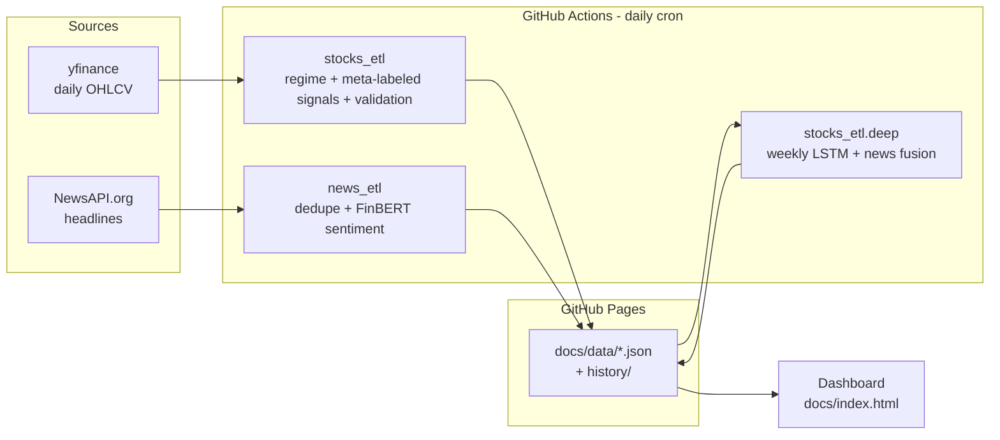

# StockSentinel

**Regime-aware quant signals with honest validation — a fully automated, zero-cost data pipeline.**

Every day, GitHub Actions downloads prices for a diversified universe (21 stocks across 8 sectors plus SPY, QQQ, GLD and TLT), detects the **market regime**, generates **meta-labeled signals** with triple-barrier risk and **fractional Kelly** sizing, validates them out-of-sample with **Purged K-Fold, CPCV and the Deflated Sharpe Ratio**, and publishes everything as static JSON on **GitHub Pages** with a live dashboard. News headlines are scored with **FinBERT**, and weekly jobs evaluate an LSTM and a price + news cross-attention model behind a promotion gate.

The methodology follows the quantitative approach described by Julián Castillo (Castle Quant), which builds on López de Prado's *Advances in Financial Machine Learning*.

**Live dashboard: https://pipe199x.github.io/StockSentinel/**

> ⚠️ **Academic project.** Signals are for demonstration only and are not investment advice.

[](https://github.com/Pipe199x/StockSentinel/actions/workflows/etl-stocks-cron.yml)
[](https://github.com/Pipe199x/StockSentinel/actions/workflows/etl-news-cron.yml)

## Architecture



- **`stocks_etl/`** — downloads daily OHLCV since 2015 (NYSE calendar) and runs the quant pipeline at 22:30 UTC, after market close, with a 07:00 UTC backup run that only works if the primary did not publish:
  - `features.py`: stationary features only (log returns, fractionally differentiated price, realized and GARCH volatility, Hurst exponent, Ornstein-Uhlenbeck z-score and half-life, beta). No RSI or moving averages.
  - `regime.py`: GARCH(1,1) with Student-t innovations and a 3-state hidden Markov model, forward-filtered so it never looks ahead.
  - `primary.py`: a fixed rule. Stay flat in a market stress regime, use momentum when Hurst ≥ 0.5, and use OU mean reversion when Hurst < 0.5.
  - `labeling.py`: triple barrier with volatility-scaled take profit and stop loss, plus a half-life time barrier.
  - `meta_model.py`: an XGBoost classifier that estimates P(the primary signal is right after costs), sized at ½ Kelly × volatility target.
  - `validation.py`: Purged K-Fold with embargo, CPCV, Deflated Sharpe, sample-size test and a trial log.
  - `risk.py`: t-Student VaR/ES, Cornish-Fisher VaR, fat-tailed Monte Carlo and losing-streak math.
- **`stocks_etl/deep/`** — weekly (Saturday) LSTM and LSTM + FinBERT cross-attention meta-models. A model is only promoted if its Deflated Sharpe exceeds 0.95 and it beats XGBoost on the same out-of-sample events.
- **`news_etl/`** — fetches the last 2 days of headlines per ticker, merges them with the accumulated history, applies a per-ticker daily cap, and scores new articles with [ProsusAI/finbert](https://huggingface.co/ProsusAI/finbert) on CPU. It also stores a 768-dimension FinBERT embedding per article for the fusion model. Runs at 12:15 UTC, with a 20:00 UTC backup run.
- **`docs/`** — the dashboard and the published dataset, served by GitHub Pages. The dashboard (`index.html`) shows a signal board, price chart with barriers, a risk panel, the honest-validation panel, deep model status and news sentiment. Daily data commits also keep the scheduled workflows active.
- **`api/`** — an optional FastAPI serving layer over the same data, runnable locally.

## Live data endpoints

| Endpoint | Content |
|---|---|
| [`manifest.json`](https://pipe199x.github.io/StockSentinel/data/manifest.json) | Last-updated timestamps per pipeline |
| [`universe.json`](https://pipe199x.github.io/StockSentinel/data/universe.json) | Tickers by sector (single source: `stocks_etl/config.yaml`) |
| [`prices_latest.json`](https://pipe199x.github.io/StockSentinel/data/prices_latest.json) | Last 60 days of prices per ticker |
| [`signals_latest.json`](https://pipe199x.github.io/StockSentinel/data/signals_latest.json) | Regime, setup, side, P(success), Kelly size, barriers and risk per ticker |
| [`validation_report.json`](https://pipe199x.github.io/StockSentinel/data/validation_report.json) | Out-of-sample stats, CPCV paths, DSR, trials, correlations, limitations |
| [`deep_report.json`](https://pipe199x.github.io/StockSentinel/data/deep_report.json) | Weekly LSTM / news-fusion evaluation and promotion status |
| [`news_latest.json`](https://pipe199x.github.io/StockSentinel/data/news_latest.json) | Recent news with FinBERT sentiment |
| [`history/`](https://pipe199x.github.io/StockSentinel/data/history/prices_history.csv) | Price history, news + FinBERT embeddings, signal history and `trials_log.csv` (the old `predictions_history.csv` is kept read-only) |

## Running locally

```bash
pip install -r stocks_etl/requirements.txt
python -m pytest tests -q
python -m stocks_etl.stocks_etl --config stocks_etl/config.yaml

# Weekly deep models (torch CPU)
pip install torch --index-url https://download.pytorch.org/whl/cpu
pip install -r stocks_etl/deep/requirements.txt
python -m stocks_etl.deep.train --config stocks_etl/config.yaml

# News (needs a free NewsAPI key; FinBERT downloads ~440MB on first run)
cp .env.example .env   # set NEWSAPI_KEY
pip install torch --index-url https://download.pytorch.org/whl/cpu
pip install -r news_etl/requirements.txt
python -m news_etl.news_client --out data/news_raw.ndjson --tickers AMZN,MSFT,GOOGL --days 2
python -m news_etl.news_etl --config news_etl/config.yaml
```

Optional local API:

```bash
pip install -r api/requirements.txt
uvicorn api.app.main:app --reload
# GET /v1/stocks, /v1/signals, /v1/validation, /v1/universe, /v1/news, /v1/manifest
```

## Notes and limitations

- NewsAPI's free tier delays articles ~24h and caps at 100 requests/day; the incremental fetch uses ~12.
- Every published performance number is out-of-sample (purged CV), and every configuration change is logged as a trial that the Deflated Sharpe penalizes. Known gaps are published in `validation_report.json` → `limitations`. These include survivorship bias, GARCH/HMM parameters fitted on the full history, and barriers checked on daily closes.
- News covers AMZN, MSFT and GOOGL only, because of the NewsAPI free-tier quota. The price + news fusion model stays in `insufficient_data` until there are enough events with news.
- Entire stack runs on free tiers: GitHub Actions, GitHub Pages, NewsAPI free plan, Hugging Face model hosting.
